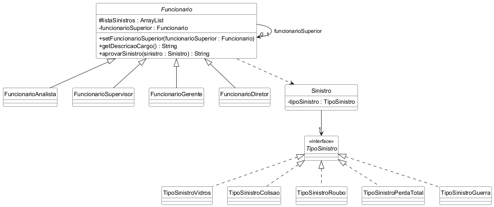

# Chain of Responsibility

Trabalho da disciplina Aspectos Avançados em Engenharia de Software.

Exemplo do padrão Chain of Responsibility em Java, com testes em JUnit 5. O tema
é o mesmo da seguradora usada nos trabalhos anteriores: quando o cliente abre um
sinistro, ele precisa ser aprovado por alguém da seguradora, e cada cargo só
pode aprovar alguns tipos.

- Analista: sinistro de vidros
- Supervisor: colisão
- Gerente: roubo
- Diretor: perda total

O sinistro sempre entra pelo analista. Se ele não puder aprovar, passa para o
superior dele, e assim por diante até chegar em quem pode. Se ninguém da
corrente puder aprovar, como no caso de guerra, que o seguro não cobre, a
resposta é "Sem aprovação".

## Diagrama de classes

